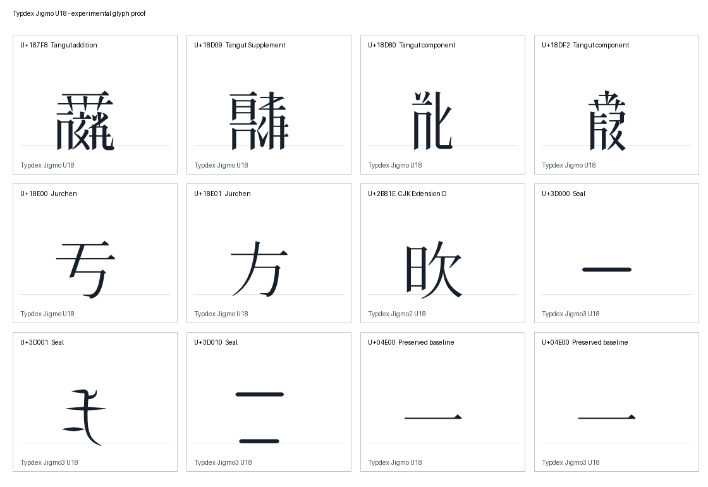

# Experimental Jigmo Unicode 18 build

**Three TTFs were successfully built** from Jigmo 20250912 and available
GlyphWiki outlines. This is a partial Unicode 18 East Asian update, named
**Typdex Jigmo U18**, **Typdex Jigmo2 U18** and **Typdex Jigmo3 U18** to distinguish
it from the published upstream release.

The local fork is based on upstream commit
`a6893b2278e39747fc3476465f7fcacf0126bca8`, on branch `unicode-18`.
Creating `typdex/jigmo` on GitHub was attempted, but the CLI had no usable
credentials. The local branch and [portable patch](unicode18.patch) preserve the
work for that remote fork.

## What was built

| Output | New mappings | Final glyph count |
| --- | ---: | ---: |
| TypdexJigmoU18-Regular.ttf | 158 | 51,006 |
| TypdexJigmo2U18-Regular.ttf | 1 | 63,051 |
| TypdexJigmo3U18-Regular.ttf | 25 | 13,557 |

The **184 additions** comprise 8 Tangut characters, 24 Tangut Supplement
characters, 115 Tangut components, 4 Jurchen characters, 6 Kana Extended-A
characters, 1 Small Kana Extension character, 1 CJK Extension D ideograph,
and 25 Seal characters. The Tangut additions include older Unicode 17 gaps;
they are explicit supplements, not mislabelled Unicode 18 additions.

The build requested **12,453 code points**. Only **184 non-empty SVGs** were
available in the completed acquisition cache. The remaining **12,269** are
listed in [build-report.json](build-report.json); they are not mapped to
replacement boxes. Subsequent locked offline builds describe uncached outlines
as `not-cached`, without claiming those glyphs can never become available.

The additions resolve **151 previously missing catalog targets**: all 147
remaining Tangut targets and 4 Jurchen targets. The other additions overlap
fonts already added to the expanded catalog.

The build preserves the published glyph order, scalar mappings, outlines,
instructions, variation sequences and GSUB table. Independent checks are
recorded in [verification.json](verification.json). New outlines use the same
scale and baseline transform as upstream `makefont.pl`, with a test calibrated
against published U+4E00. A non-empty outline is not a native-reader validation
of character correctness or typographic quality.



## Reproduce the locked build

From the catalog repository root, with its FontTools dependency installed:

```sh
.venv/bin/python experiments/jigmo/build_unicode18.py \
  --work experiments/jigmo/inputs \
  --manifest experiments/jigmo/build-report.json \
  --output artifacts/jigmo-unicode18
```

The locked SVGs and Unicode inputs are committed here. The published Jigmo ZIP
is fetched once and verified against its pinned SHA-256. Later runs can add
`--offline`. A manifest build fetches only the previously available glyphs and
rejects changed bytes; it does not repeat all 12,453 discovery requests.

To repeat the preservation checks:

```sh
.venv/bin/python experiments/jigmo/verify_unicode18.py \
  --base-zip experiments/jigmo/inputs/Jigmo-20250912.zip \
  --fonts artifacts/jigmo-unicode18 \
  --report artifacts/jigmo-unicode18/build-report.json \
  --output artifacts/jigmo-unicode18/verification.json
```

To discover newly available outlines instead:

```sh
.venv/bin/python experiments/jigmo/build_unicode18.py \
  --work .cache/jigmo-unicode18-discovery \
  --extra-codepoints experiments/jigmo/unicode18-extra.txt \
  --output artifacts/jigmo-unicode18-new
```

The incremental builder needs FontTools, not FontForge. It reuses the published
glyphs and variation tables and compiles only the new outlines. The fork also
updates the upstream full pipeline's UCD URL and Jurchen/Seal name selection,
but the full multi-hour FontForge rebuild was not run.

Compiled fonts are packaged locally at
`artifacts/jigmo-unicode18-experimental.zip`. They are excluded from the catalog
Git history. The archive contains the three fonts, input manifest, build script,
source SVGs and relevant license notices.

## Licenses and provenance

The upstream tools and this build program use MIT. Published Jigmo font data
uses [CC0](JIGMO-CC0-LICENSE.txt). Newly fetched GlyphWiki data retains the
[GlyphWiki data license](GLYPHWIKI-DATA-LICENSE.txt), permitting free use,
reproduction and modification. The license text was retrieved from Mozilla's
retained [GlyphWiki license notice](https://github.com/mozilla/gecko-dev/blob/master/layout/reftests/fonts/glyphwiki-license.txt)
because the primary wiki license page returned HTTP 403 during this session;
its notice identifies the Japanese original as authoritative.

Unicode inputs retain [their license](inputs/UNICODE-LICENSE.txt).
Every usable SVG has its source URL and byte hash in the build report.
Each output font has a recorded hash and an embedded description distinguishing
the published CC0 data from the added GlyphWiki data. No third-party
proprietary fonts are merged into this build.
